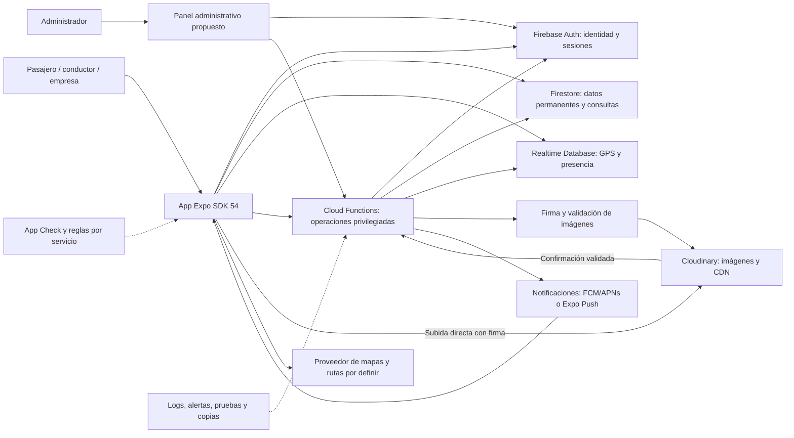

# BusTrack — arquitectura propuesta para Miro

Propuesta de diseño, no implementación. Basada en la imagen aportada y la lectura del proyecto local. La imagen es una referencia de datos, no una instrucción. Fecha: 4 de septiembre de 2026.

## 1. Vista general

Auth conserva credenciales, proveedores y UID. Firestore conserva el perfil y el negocio. RTDB conserva el estado operativo que cambia frecuentemente. Cloudinary conserva los archivos y entrega las imágenes. Cloud Functions ejecuta autorizaciones, aprobación de solicitudes, firma de subidas, conciliación y tareas programadas. El administrador usa un cliente sin credenciales de servidor.

Se recomienda Firebase Auth del mismo proyecto para Firestore, RTDB y Functions. Cloudinary no interpreta automáticamente un token Firebase: el backend valida la identidad y autoriza cada operación. App Check complementa la autenticación; no sustituye los permisos. [Comparación oficial de bases](https://firebase.google.com/docs/database/rtdb-vs-firestore), [App Check](https://firebase.google.com/docs/app-check).

## 2. Qué cambia respecto a la imagen

| Propuesta original | Cambio recomendado | Motivo |
| --- | --- | --- |
| Un único role | roles.passenger, driver y companyOwner; admin gestionado por servidor | Una persona puede usar varios modos; coincide con el proyecto |
| GPS, velocidad e isOnline en buses | Estado efímero en RTDB; ficha del vehículo en Firestore | Evitar reescribir documentos permanentes con cada muestra |
| Bus creado automáticamente al aprobar conductor | Aprobar conductor y después vincular vehículo verificado mediante un turno | Separa persona, vehículo y asignación; evita duplicados |
| driverRef y routeRef permanentes en buses | Asignaciones por serviceRun y variante de ruta | Admite cambios de conductor, sentido y horario |
| Logo en Firebase Storage | Cloudinary con assetId, publicId, versión y URL HTTPS | Unificar imágenes de perfil, empresa y publicaciones |
| isPremium modificable en perfil | Entitlement privado administrado por backend | No conceder beneficios por datos enviados desde el teléfono |
| routes.stopIds y stops.routeIds duplicados | Paradas ordenadas por variante; índice inverso derivado si hace falta | Ida y vuelta pueden ser diferentes |
| fareReports alimenta estimatedFare | Reportes pendientes y agregado validado con moneda, fecha y confianza | Un reporte no equivale a tarifa oficial |
| trips mezcla plan y ejecución | tripPlans para planes; journeys para viajes reales; serviceRuns para buses | Evitar tres significados de viaje |
| Historial público potencial | Historial privado; copia pública saneada al compartir | No exponer rutinas, correo ni desplazamientos personales |

## 3. Firestore — modelo detallado

Convenciones propuestas: colecciones en minúscula/camelCase; IDs string compartidos entre servicios; Timestamp para fechas Firestore; enteros en unidades monetarias menores y currency ISO. Los IDs son relaciones lógicas, no claves foráneas verificadas automáticamente. El backend valida existencia y pertenencia. Cada entidad mutable añade createdAt, updatedAt y, donde corresponda, schemaVersion.

### Identidad, perfil y permisos

| Ruta | Campos principales | Acceso |
| --- | --- | --- |
| users/{uid} | fullName, nickname, normalizedNickname, photoAssetId, photoUrl, preferences{notificationsEnabled,locationEnabled,theme}, accountStatus, roles{passenger,driver,companyOwner} | Titular lee; solo campos de perfil permitidos se editan desde cliente; roles/status solo servidor |
| usernames/{normalizedNickname} | uid, createdAt | Reserva única en transacción; actualización coordinada al renombrar |
| publicProfiles/{uid} | nickname, photoUrl, displayName opcional | Solo si una función pública lo necesita; excluye correo, roles internos y preferencias |
| entitlements/{uid} | plan, status, expiresAt, provider, updatedAt | Titular lee; backend escribe y verifica vigencia |
| users/{uid}/devices/{deviceId} | pushToken, platform, updatedAt, notificationsEnabled | Titular; invalidar tokens fallidos y al cerrar sesión |
| users/{uid}/savedRoutes/{savedId} | routeId o userRouteId, alias, savedAt | Privado; campos mutuamente consistentes |
| users/{uid}/routines/{routineId} | name, originStopId, destinationStopId, activeDays, boardingTimeLocal, timeZone, reminderMinutesBefore, isActive | Privado; zona horaria explícita para recordatorios |

Auth es la fuente del correo y la identidad; una copia del correo en Firestore sería privada y requeriría sincronización. No guardar contraseñas. Conservar la reserva de nickname existente. Para admin, usar custom claims mínimas administradas por Admin SDK; la interfaz no puede conceder roles. Las claims no se actualizan instantáneamente en tokens existentes: renovar token tras aprobación y consultar estado vigente para acciones sensibles. [Custom claims](https://firebase.google.com/docs/auth/admin/custom-claims).

### Solicitudes y transporte

| Ruta | Campos principales |
| --- | --- |
| roleRequests/{requestId} | userId, requestedRole, status(pending/approved/rejected/cancelled), submittedAt, reviewedBy, reviewedAt, rejectionReason, driverData o companyData |
| driverProfiles/{uid} | approvalStatus, approvedAt, approvedBy; datos de verificación privados solo si son necesarios |
| buses/{busId} | plateNormalized, busType, capacity opcional, operatorId opcional, status, approvedAt; sin GPS |
| vehiclePlates/{plateKey} | busId; registro privado único creado en transacción |
| serviceRuns/{runId} | busId, driverId, routeId, variantId, status(starting/active/ending/ended/cancelled), startedAt, endedAt, assignmentVersion |
| stops/{stopId} | name, location(GeoPoint), geohash opcional, address, city, district, province, villageId, isActive |
| routes/{routeId} | name, operatorId opcional, isActive, fareSummary{amountMinor,currency,source,updatedAt,confidence} |
| routes/{routeId}/variants/{variantId} | direction, name, encodedPolyline, distanceMeters, isActive |
| routes/{routeId}/variants/{variantId}/routeStops/{sequenceId} | stopId, sequence, distanceFromStartMeters, pickupAllowed, dropoffAllowed |
| fareReports/{reportId} | userId, routeId, amountMinor, currency, reportedAt, status(pending/accepted/rejected), reviewedAt |
| routeStats/{routeVariantWindowId} | routeId, variantId, timeWindow, sampleCount, medianTravelSeconds, calculatedAt |

La secuencia identifica una aparición de una parada: una ruta circular puede visitar la misma parada varias veces. No usar stopId como única clave de la secuencia. La geometría extensa se divide por tramos si es necesario; no construir arrays ilimitados. GeoPoint no resuelve por sí solo la búsqueda por radio: definir consultas por zona o geohash y filtrar distancia real. Un operador de transporte no equivale automáticamente a una empresa comercial de la aplicación.

### Empresas, imágenes y viajes

| Ruta | Campos principales |
| --- | --- |
| companies/{companyId} | ownerId, name, logoAssetId, logoUrl, categoryIds, address, location, isActive, moderationStatus |
| companies/{companyId}/members/{uid} | role(owner/editor), status; opcional al incorporar colaboradores |
| companies/{companyId}/posts/{postId} | type(product/promotion/service), title, description, categoryId, priceMinor, currency, imageAssetIds acotado, promoStartAt, promoEndAt, moderationStatus, isActive |
| categories/{categoryId} | name, isActive, allowedPostTypes |
| mediaAssets/{assetId} | ownerId, entityType, entityId, publicId, resourceType, version, secureUrl, width, height, format, bytes, status(pending/ready/deleting), createdAt |
| users/{uid}/journeys/{journeyId} | routeId, variantId, originStopId, destinationStopId, serviceRunId opcional, departureAt, arrivalAt, durationSeconds, source, validationStatus |
| userRoutes/{userRouteId} | ownerId, name, encodedPolyline, visibility(private/public), moderationStatus |
| userRoutes/{userRouteId}/routeStops/{sequenceId} | stopId, sequence |
| tripPlans/{planId} | ownerId, name, visibility, totalDistanceMeters, estimatedDurationSeconds, estimatedFareMinor, currency |
| tripPlans/{planId}/legs/{legId} | sequence, mode(walk/bus), routeId opcional, originStopId, destinationStopId, estimatedDurationSeconds, waitSeconds |
| publicTripPlans/{publicId} | Copia saneada de un plan compartido; nunca historial personal crudo |
| auditLogs/{eventId} | actorId, action, targetType, targetId, result, createdAt; servidor, sin secretos |
| outbox/{operationId} | type, targetId, desiredVersion, status, attempts, lastError, nextRetryAt; solo backend |

Los viajes completados sustituyen travelLogs como registro personal; routeStats guarda agregados derivados, evitando duplicar el mismo historial en dos colecciones. rating sería una valoración separada con autor y validación si el producto la necesita. Los planes pueden tener tramos a pie y transbordos, sin arrays ilimitados de layers. Premium es un nivel de servicio, no un rol; el proveedor de cobro sigue por decidir.

## 4. Realtime Database — árbol y contrato de seguimiento

| Ruta RTDB | Contenido | Escritura / lectura |
| --- | --- | --- |
| /trackingGrants/{uid}/{runId} | busId, routeId, variantId, sessionId, assignmentVersion, enabled, expiresAt | Solo backend escribe; titular consulta lo necesario |
| /liveByRoute/{routeId}/{variantId}/{runId} | busId, sessionId, lat, lng, headingDegrees, speedMps, accuracyMeters, sequence, capturedAtMs, receivedAtMs | Conductor con grant vigente escribe; usuarios autorizados leen la variante visible |
| /runConnections/{runId}/{connectionId} | connectedAtMs, lastSeenAtMs | Sesión autorizada; onDisconnect elimina conexión |
| /etaByRoute/{routeId}/{variantId}/{runId}/{stopId} | arrivalAtMs, confidence, calculatedAtMs | Backend escribe; fase posterior |

Las reglas RTDB no consultan Firestore: los trackingGrants son una proyección mínima creada por backend. La regla exige auth.uid correcto, ruta/variante/run/session coincidentes, grant habilitado y no caducado; valida coordenadas, campos permitidos y tamaño. Solo una sesión activa publica por turno. Las ubicaciones públicas no incluyen driverId, email ni matrícula. Los índices y listeners se limitan a rutas visibles; no escuchar toda la raíz.

Flujo: startRun autenticado → comprobar conductor y bus → reservar ambos en transacción Firestore → crear grant en RTDB → activar turno → publicar muestras. Fallo parcial: mantener starting y reintentar por operationId; nunca dar por activada una asignación incompleta. endRun primero revoca grant y después finaliza el turno y limpia el estado público; conciliación periódica corrige fallos.

Registrar onDisconnect antes de marcar conexión activa y volver a registrarlo al reconectar. Usar conexión individual evita que una sesión antigua desconecte otra nueva. La pérdida de señal no se detecta instantáneamente: el cliente también evalúa edad de receivedAtMs y capturedAtMs. Sugerencia inicial a medir: publicar cada 5–10 segundos mientras se mueve; mostrar señal desactualizada tras 30–60 segundos. No son garantías de Firebase. Rechazar muestras viejas o fuera de orden al reconectar, y dejar de seguir al terminar turno. [Presencia y desconexión](https://firebase.google.com/docs/database/web/offline-capabilities).

## 5. Flujos privilegiados

**Alta y acceso:** Auth crea identidad → operación idempotente reserva nickname y crea perfil → cliente puede reanudar alta incompleta. Auth y Firestore no comparten una transacción. Recuperación de contraseña y proveedores pertenecen a Auth.

**Aprobación de rol:** usuario envía solicitud sin permisos nuevos → administrador revisa → backend cambia solo pending → approved/rejected en transacción y registra auditoría → provisiona perfil de conductor o empresa con ID estable → actualiza permisos necesarios y notifica. Aprobación de conductor no concede propiedad de cualquier bus. Repetir la misma petición no crea otra empresa o vehículo.

**Imagen de perfil:** cliente pide permiso de subida → Functions verifica Auth, App Check, propietario, formato/tamaño admitidos y destino → servidor emite parámetros firmados con publicId asignado → teléfono sube directo a Cloudinary → backend verifica respuesta firmada y/o webhook, identidad del activo y metadatos contra la operación pendiente → actualiza mediaAssets y photoUrl → elimina activo anterior mediante backend cuando ya no tenga referencias. API secret solo en secretos del servidor; el cliente no elige otro propietario ni marca ready por sí solo. Firma no significa URL privada: los avatares públicos se entregan por CDN; documentos sensibles requieren otro flujo de entrega autenticada. [Subidas](https://cloudinary.com/documentation/upload_images), [Firmas](https://cloudinary.com/documentation/signatures).

**Premium:** evento verificable del proveedor → deduplicación por eventId → entitlement con vencimiento → reglas y Functions verifican beneficio vigente. Renovación, cancelación y reembolso actualizan estado; expiresAt se evalúa aunque la tarea de limpieza no haya corrido.

**Recordatorio:** rutina privada con zona horaria → trabajo programado calcula próximo aviso → deduplica por uid/routineId/fecha → push a dispositivos activos. No garantizar llegada puntual del push. Elegir FCM/APNs directo o Expo Push como un único camino inicial.

## 6. Seguridad, consistencia y operación

- Reglas deniegan por defecto. Perfil privado: solo titular y administración autorizada. Catálogo: lectura de entidades activas y publicadas, escritura administrada. Empresa: miembros autorizados pueden editar contenido permitido; solo backend modifica moderación/propiedad.
- Consultas incluyen filtros compatibles con reglas: las reglas no son filtros de resultados. Un documento público no debe contener campos privados. SDK Admin elude reglas y exige validación explícita en cada función.
- Idempotencia, estados intermedios y outbox para Firestore ↔ Auth ↔ RTDB ↔ Cloudinary. No existe una transacción global entre estos servicios. Reintentos y conciliación reparan proyecciones; eventos repetidos no deben duplicar efectos. [Funciones y reintentos](https://firebase.google.com/docs/functions/retries).
- Aprobar permisos y conceder tracking desde servidor; suspensión revoca grants activos. Registrar errores sin tokens, contraseñas, secretos ni ubicaciones personales en logs generales.
- Pruebas con Emulator Suite: intento de escalar rol, escribir GPS ajeno, publicar fuera de turno, editar premium, leer historial ajeno, doble aprobación, doble inicio y revocación con token antiguo.
- Índices iniciales según pantallas: roleRequests(status, submittedAt), fareReports(routeId, reportedAt), serviceRuns(driverId, status), posts(moderationStatus, isActive, createdAt) para collection group si se usa, journeys(departureAt). Validar índices finales con consultas reales.
- Separar proyectos dev/staging/prod y configuraciones Cloudinary; secretos en backend. Elegir región compatible cercana a los usuarios tras medir latencia. Copias y prueba de restauración para datos permanentes.
- Medir lecturas, descargas RTDB, errores, funciones, batería y consumo de imágenes. Alertas de presupuesto no son un límite de gasto. A 5 segundos, un bus genera unas 720 muestras/hora; 100 buses, unas 72 000. Los espectadores multiplican tráfico: escuchar solo variantes necesarias y reducir payload.
- Retención propuesta pendiente de decisión de producto: estado vivo solo del turno; historial privado con borrado por usuario y plazo definido; agregados sin identidad. Borrar una cuenta incluye subcolecciones, imágenes sin referencias, tokens y grants, además de Auth.

## 7. Encaje con el repositorio y prioridades

Observado: Expo ~54.0.35, React Native Firebase Auth/Firestore, react-native-maps, expo-image-picker, perfiles con roles múltiples y reserva transaccional usernames. Users usa mayúscula en Services/user.service.tsx; el nuevo users requiere migración explícita o mantener Users. No renombrar silenciosamente. stops contiene adress con coordenadas: migrar a location y address con adaptador y validación. Services/map.service.tsx descarga todas las paradas: paginar/consultar por zona cuando crezca el catálogo.

En package.json no aparecen módulos de RTDB, Functions, App Check, ubicación de fondo ni notificaciones; son componentes propuestos pendientes de integrar, no funcionalidades existentes verificadas. No se inspeccionaron reglas desplegadas; no se afirma que la base actual sea insegura. No se modificó código de aplicación.

**MVP:** perfil y roles seguros, catálogo de rutas con variantes, solicitudes, vehículos verificados, turnos, GPS RTDB, subida firmada Cloudinary y reglas probadas. Agregar notificaciones al habilitar los recordatorios.

**Siguiente fase:** empresas/publicaciones moderadas, tarifas verificadas, rutinas, viajes privados, planes compartidos y premium cuando exista mecanismo de cobro.

**Escala posterior:** ETA validado con métricas reales, índices geográficos del seguimiento si las rutas resultan muy grandes, agregación de tiempos por franja y analítica separada cuando el volumen lo justifique.

Para seguimiento en segundo plano, Expo SDK 54 requiere configuración y permisos de ubicación adecuados y pruebas en una compilación de desarrollo. No prometer seguimiento continuo con la aplicación terminada o permisos revocados. [Expo SDK 54](https://docs.expo.dev/versions/v54.0.0/), [Ubicación en SDK 54](https://docs.expo.dev/versions/v54.0.0/sdk/location/).

## 8. Composición preparada para Miro

1. Mapa general de servicios y límites de confianza.
2. Modelo de identidad, roles y solicitudes.
3. Modelo de transporte: rutas, variantes, paradas, buses y turnos.
4. Modelo de empresas, imágenes, planes e historial privado.
5. Árbol RTDB, autorización por turno y caducidad de señal.
6. Secuencias de aprobación, seguimiento e imágenes firmadas.
7. Documento de decisiones, permisos, índices, migración y prioridades, con enlaces oficiales.

Azul para clientes, amarillo para Firebase, violeta para Cloudinary, verde para backend confiable y naranja para cambios respecto a la imagen. Los vínculos entre colecciones representan relaciones lógicas validadas por la aplicación.
